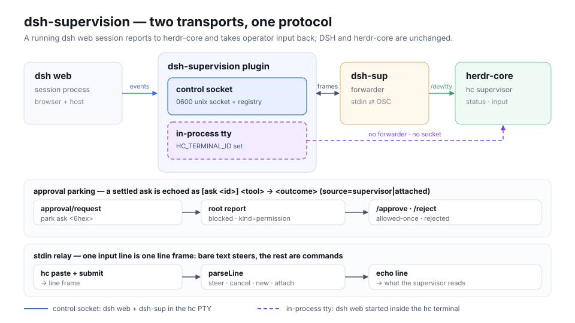

# dsh-supervision

[English](README.md) | [中文](README.zh-CN.md)

[](https://www.npmjs.com/package/dsh-supervision)
[](package.json)


**Bridge a running DSH session into any terminal supervisor — it sees the state, and it can steer.** The plugin mounts inside the `dsh web` process you already run: [**OSC 7501**](https://www.superlogical.com/rex/docs/build/program-status) records go out on the terminal, and operator input comes back into that same session. herdr-core is one supported supervisor; any supervisor that reads OSC 7501 and can write lines back can drive a bridged session, with no changes to DSH or the supervisor.

## What you get

- **One status record per session.** The bridged session is the root record — `idle`, `working`, `done`, `blocked` or `error`; other sessions in the same process are child records carrying `id=`.
- **Operator input goes back in.** Bare text steers a running turn, `/cancel` ends it, `/status`, `/new` and `/attach` inspect and switch sessions, and `/approve` or `/reject` settle parked asks — all from the terminal.
- **Approvals stop living in another surface.** A parked ask turns the root record into `blocked · kind=permission`, is settled from the terminal, and the GUI shows a supervision banner with **Take back control** — so the person in the browser always sees who holds the session and has a way to take it back.

## Works with

| Supervisor | How it connects | What it needs |
|---|---|---|
| herdr-core (`hc`) | in-process tty via its own `HC_TERMINAL_ID` (or `DSH_SUP_TERMINAL_ID` when the host exports one) **and** the control socket with `dsh-sup` in its PTY; both are open at once | a `dsh web` started inside the supervised terminal, plus any PTY for the forwarder |
| Any supervisor that reads OSC 7501 | control socket + `dsh-sup` in its own PTY | it must read the PTY's OSC output and be able to write lines to that PTY's stdin |
| Another supervisor wanting in-process mode | set `DSH_SUP_TERMINAL_ID` | the variable is read, never written, by this package; any supervisor can set it |
| GUI-only `dsh web` | nothing | the plugin exposes an inert socket and nothing else |

## Quick start

### Install

**Plugins page** — in DeepSeek Harness open the **Plugins** page, click **Add plugin**, enter `dsh-supervision` and install; then restart as the host asks. The GUI writes into the `web` profile, the same profile the command below targets.

**CLI** — for scripted setups:

```sh
dsh plugin --profile web add dsh-supervision   # the plugin, into the web profile
npm i -g dsh-sup                               # the forwarder, for the supervisor's PTY
```

`dsh-sup` is a separate package because it runs as its own program in the supervisor's PTY. Pin a version with `@<version>`.

### Connect a session

```sh
dsh-sup                                  # create a session in the dsh web process's directory
dsh-sup --cwd ~/work/project             # create it elsewhere (resolved here, then sent absolute)
dsh-sup attach session-abc123            # attach an existing session (or: dsh-sup session-abc123)
dsh-sup --pid 4711 new                   # pick the backend when several dsh web processes run
dsh-sup list                             # list every session on every live backend
```

`list` prints one table for every live backend and binds nothing. It answers from the same account the sidebar groups — the sessions a Workspace owns — so a persisted session appears even when no agent is loaded for it (`LIVE no`), while archived sessions (unless an active bridge holds one), blank sessions (never had a turn) and sessions no Workspace owns (subagent logs, folded history) are omitted. `PID` names the `dsh web` process a row came from, so a multi-backend listing stays attributable:

```text
SESSION            PID    CWD                LIVE  BRIDGED
session-4f2a…      4711   /Users/me/work     yes   -
```

Backends are found through `$DSH_HOME/supervision` (`~/.dsh/supervision` when `DSH_HOME` is unset). A bridge needs exactly one live backend; with several, the refusal names each candidate's `pid` and socket, and `--pid` picks one. `--cwd` applies to `new` and `list` only; `list` without it shows every session, with the CWD column naming where each one lives.

The bridge reads stdin in the terminal's own line mode — it never enters raw mode — so `Ctrl+C`, `Ctrl+Z`, `Ctrl+\`, input echo and line editing keep working as they do without the plugin. `Ctrl+S`/`Ctrl+Q` stay the terminal driver's flow control: on the `/dev/tty` surface a paused terminal holds the bridge's records in an ordered queue instead of blocking the host, and they flush on resume. The stdout fallback (no controlling terminal) keeps a synchronous write, so there a paused terminal still stalls it. Operator input is read a line at a time, after Enter; the line discipline caps one line at its `MAX_CANON` (4 KB on Linux, 1 KB on macOS), so a much longer paste reaches the agent truncated.

**Empty sessions stay out of the web UI.** A session created here is attached to its project, but the DSH sidebar lists a session only after its first message. Until then it exists in `dsh-sup list` and on the bridge, with no row under the project. Send one line from the terminal (or attach and steer) and it appears.

### Answer an approval

Ask where the session stands, then answer the parked ask by id:

```text
/status
session=session-4f2a… state=blocked turn=3 asks=3f9ac1

/approve 3f9ac1
[ask 3f9ac1] bash → allowed-once (source=supervisor)
```

`/y` and `/n` answer the only parked ask; with more than one parked they refuse and ask you to name it.

### Take back control

While a session is bridged the GUI shows a supervision banner above the composer — `Supervised from <terminal> (pid <n>) · approvals are answered there` — with a **Take back control** button. It posts to the reclaim route; the bridge is dropped, the supervisor reports the clear record, and a `dsh-sup` forwarder exits `0`.

## How it reports

One `dsh web` process owns one session tree; the plugin mounts in it and opens its control socket, plus an in-process tty when the process runs inside a supervised terminal.

```text
dsh web (the process you already run)
└── dsh-supervision plugin
      ├── control socket   $DSH_HOME/supervision/<pid>-<8hex>.sock   (0600)
      │     └── dsh-sup in the supervisor's PTY ── OSC 7501 + echo lines ──▶ supervisor (reads OSC 7501)
      └── in-process tty   (added when DSH_SUP_TERMINAL_ID or HC_TERMINAL_ID is set)
            └── OSC 7501 written to this process's own /dev/tty
```

**Activation.** The plugin always opens its socket discovery surface — the listener, the `0600` socket and the `<pid>-<8hex>.json` registry entry that names it — so a forwarder has something to connect to. The effect layer (session listeners, OSC reports, echo lines, stdin handling) mounts per bridge, which is the same fact as "a forwarder is connected". A GUI-only `dsh web` therefore exposes an inert socket and nothing else. With `DSH_SUP_TERMINAL_ID` non-empty (or herdr-core's `HC_TERMINAL_ID`) the process also supervises the terminal it runs in: the same records go to its own `/dev/tty`, while the socket stays open for a `dsh-sup` elsewhere. A session still has exactly one bridge across both surfaces, so a second attach is refused as `busy`. If the terminal cannot be opened — no `/dev/tty` and a non-TTY stdout, or a stdin that is not a terminal — the plugin writes the reason to stderr and keeps the socket surface.

## For implementers & agents

This half is reference material for implementers and coding agents; if you only want to use the plugin, jump to [Links](#links).

### Repo map

| Path | What lives there |
|---|---|
| `src/` | the host plugin and the browser supervision banner (`src/client/`) |
| `packages/protocol` | the OSC 7501 encoder and the NDJSON frame codec |
| `packages/cli` | the `dsh-sup` forwarder |
| `lib/` | build output |
| `docs/` | figures and their captions |
| `.agents/adr` and `.agents/knowledge` | decisions and the architecture notes behind them |
| `.changes/` | release fragments |
| `locale/` | plugin-page strings |

### Supervision protocol

The facts a supervisor needs, all of them on this repository's wire:

**Socket and registry.** One Unix socket per `dsh web` process, mode `0600`, at `$DSH_HOME/supervision/<pid>-<8hex>.sock`, next to a `<pid>-<8hex>.json` entry `{proto, pid, socket, startedAt, dshVersion}` written atomically and mode `0600`. A session has exactly one bridge: a second connection claiming it is refused with `error` code `busy` and closed. Frames are NDJSON, `PROTO` is `1`, one frame is at most 64 KiB; the forwarder splits its own stdin on `\r`, `\n` or `\r\n` and sends one `line` frame per input line.

| Direction | Frames |
|---|---|
| forwarder → plugin | `hello` (`attach` a session, `new {cwd}`, or bare), `line {text}`, `list {cwd?}`, `bye` |
| plugin → forwarder | `welcome`, `osc {data}`, `echo {text}`, `sessions {items}`, `error {code, message}`, `bye {reason}` |

`error.code` is one of `busy`, `unknown-session`, `create-failed`, `locked`, `protocol`, `internal`.

**OSC 7501 output.** One record is replaced whole on every report, so every field is restated:

```text
ESC ] 7501 ; state=<idle|working|done|blocked|error>[ :id=<child id>][ :kind=<permission|question|auth>][ :app=<word>][ :title=<base64>][ :msg=<base64>] ST
```

A clear is `state=clear` for the root, `state=clear:id=<id>` for one child record. `kind` is legal only on `blocked`; a parked approval is the root `blocked:kind=permission` record carrying `msg=<tool> <reason> [ask <id>]`. Caps: sequence under 4096 bytes, title 192 bytes, `msg` 2048 bytes, id 128 bytes as `/`-joined segments of at most 32 bytes each (8 segments). The root word is `blocked` > `working` > `done` / `error` / `idle`, and a parked approval outranks a live turn. The reporting surface is `/dev/tty` on both paths (stdout when it is a TTY); that is what the supervisor reads, not the plugin's or the forwarder's stdout.

**Routes**, served only when the host mounts a webserver:

| Route | Answer |
|---|---|
| `GET /dsh-supervision/state` | `{"proto":1,"sessions":{"<session id>":{"bridged":true,"terminal":"…","pid":<n>,"since":<ms>,"asks":["<ask id>"]}}}`; `405` for another method |
| `POST /dsh-supervision/reclaim` | `content-type: application/json`, body `{"session":"<id>"}` under 4 KiB → `200 {"reclaimed":true}`; `409 {"reclaimed":false}` when no bridge held it; `415` for another content type, `400` for a bad body |

**Echo lines** the supervisor reads, in the order they are written: `[turn <n>] <state>` on a state change, `[ask <id>] <tool> parked (<session>)`, `[ask <id>] <tool> → <outcome> (source=supervisor|attached)`, the `/status` answer above, `refused: <n> approval(s) parked`, `new failed: …`, `attach failed: …`, `unknown command /<verb>`.

**Exit codes of `dsh-sup`:** `0` clean `bye`, `1` backend lost, `2` usage or no live backend, `3` `busy`, `4` `locked`, `5` `create-failed`, `6` `protocol` (a frame this process refused, so the backend is alive).

### Configuration

Six keys, all of them read by `src/index.ts`; an unknown shape is refused with a field-level issue instead of half-applying.

| Key | Default | What it does |
|---|---|---|
| `enabled` | `true` | Mount anything at all. `false` is a hard off switch: no socket, no routes, no banner. |
| `programStatus` | `true` | Emit OSC 7501 reports. Off leaves the socket answering `list` only. |
| `echo` | `true` | Mirror state changes and approval decisions as `echo` lines for the supervisor. |
| `app` | `"dsh"` | The program word every report restates. |
| `titleFrom` | `"cwd-basename"` | Where the root title comes from: `cwd-basename`, `session-title`, or `none`. |
| `socketDir` | `$DSH_HOME/supervision` | Registry and socket directory. |

Environment variables it reads:

| Variable | Read by | Effect |
|---|---|---|
| `DSH_HOME` | plugin and `dsh-sup` | Registry directory base; defaults to `~/.dsh`. |
| `DSH_SUP_TERMINAL_ID` | plugin | Non-empty ⇒ an additional in-process tty transport; the control socket and registry stay open. |
| `DSH_SUP_TERMINAL_NAME` | plugin | The supervisor label the state route reports; defaults to `dsh-sup`. |
| `HC_TERMINAL_ID` | plugin | herdr-core compatibility: the same transport, read only when `DSH_SUP_TERMINAL_ID` is unset or empty. |
| `HC_TERMINAL_NAME` | plugin | herdr-core compatibility: the label, read only when `DSH_SUP_TERMINAL_NAME` is unset or empty. |

Both `DSH_SUP_*` variables and their `HC_*` fallbacks are read, never written, by this package.

### Invariants

A change must not break these:

- **One bridge per session.** A second connection claiming a bridged session is refused with `busy`; the in-process path holds one binding per process, and `/attach` switches it rather than adding a second.
- **A record is replaced whole.** Every report restates every field that still applies; a field left out is a field cleared.
- **A parked approval outranks a live turn.** The root word order is `blocked` > `working` > `done` / `error` / `idle`, and a session switch (`/new`, `/attach`) is refused while an ask is parked.
- **Teardown settles every parked ask before the socket closes.** Disconnect, dispose, reclaim or an asker's withdrawal resolves each ask as `cancelled`; fail closed, never leave one dangling.
- **The terminal variables are read only.** The in-process transport and its label are chosen by the environment, never by configuration, and nothing writes those variables.
- **Caps are hard limits.** The encoder drops a record it cannot express within its caps rather than truncating it, and a frame over 64 KiB is refused locally.

## Links

| Doc | Content |
|---|---|
| [CHANGELOG.md](CHANGELOG.md) | released changes |

## License

Released under the **MIT** License — the `license` field in [package.json](package.json) is authoritative.
