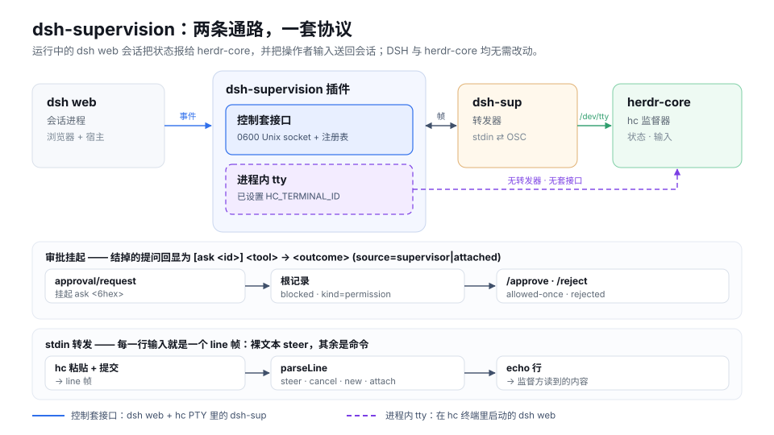

# dsh-supervision

[English](README.md) | [中文](README.zh-CN.md)

[](https://www.npmjs.com/package/dsh-supervision)
[](package.json)


把你已经在运行的 `dsh web` 进程交给 herdr-core（`hc`）监督。插件就装在那个进程里：它把被监督的会话以 **OSC 7501** 记录写到终端上，同时把操作者输入——中途 steer、取消本轮、新建或接管会话、批准或驳回挂起的工具审批——送回同一个会话。因此监督的是你真正在用的那个会话，而不是它的第二份拷贝。整条通路有两种承载方式：由运行在 `hc` PTY 里的 `dsh-sup` 转发器驱动**控制套接口**，或者在 `dsh web` 本身就运行于 `hc` 终端时，直接使用**进程自己的 tty**，此时既没有转发器也没有套接口。DSH 与 herdr-core 都不需要改动。

## 拓扑

一个 `dsh web` 进程拥有一棵会话树，插件挂在其中，并且只开一条通路。

```text
dsh web (the process you already run)
└── dsh-supervision plugin
      ├── control socket   $DSH_HOME/supervision/<pid>-<8hex>.sock   (0600)
      │     └── dsh-sup in the hc PTY ── OSC 7501 + echo lines ──▶ herdr-core
      └── in-process tty   (only when HC_TERMINAL_ID is set)
            └── OSC 7501 written to this process's own /dev/tty
```

**挂载规则。**套接口这条路上，插件总是先把发现面打开——监听器、`0600` 套接口，以及指向它的 `<pid>-<8hex>.json` 注册表条目——这样转发器才有东西可连。效果层（会话监听、OSC 上报、echo 行、stdin 处理）按桥接打开，"有一条桥接"和"有转发器已连接"是同一件事。因此一个只开 GUI 的 `dsh web` 只暴露一个不干活的套接口，别的什么都没有。当 `HC_TERMINAL_ID` 非空时，进程自己就是监督者：不创建任何东西，终端本身就是完整的发现面。如果这个终端打不开——既没有 `/dev/tty`、stdout 也不是 TTY，或者 stdin 不是终端——插件把原因写到 stderr 并完全不挂载，宿主因此保住它的会话。

**审批把根记录压成挂起。**只要还有桥接，插件就为这棵会话树在前面插入一个 `approval/request` 监听器。提问以六位十六进制 id 挂起，根记录变成 `state=blocked:kind=permission`，`msg=<tool> <reason> [ask <id>]`；用 `/approve <ask>`（`allowed-once`）或 `/reject <ask>`（`rejected`）结掉它，只挂着一个时也可以用 `/y` / `/n`，提问方撤回时则以 `cancelled` 结掉。有提问挂起期间，切换会话（`/new`、`/attach`）会被拒绝；插件卸载时会在套接口关闭之前把每个挂起的提问按失败结掉。

**stdin 转发。**转发器按 `\r`、`\n` 或 `\r\n` 切分自己的 stdin，把每一行作为 `line` 帧发出；插件解析后执行：裸文本 steer 给 agent，`/cancel` 取消本轮，`/status` 回答 `session=… state=… turn=… asks=…`，`/new <绝对路径>` 与 `/attach <session-…>` 切换会话，`/approve` / `/reject` 按 id 应答提问。两条路的回报面都是 `/dev/tty`（stdout 是 TTY 时才退而用它）；herdr-core 读的是那里，不是我们的 stdout。

**把会话拿回来。**只要会话处于桥接状态，GUI 输入框上方就会出现监督横幅——`Supervised from <terminal> (pid <n>) · approvals are answered there`——旁边是「Take back control」按钮。它请求回收路由；桥接被丢弃，监督方收到清除记录，`dsh-sup` 转发器以 `0` 退出。

## 快速开始

### 安装

**插件页面**——在 DeepSeek Harness 里打开 Plugins 页面，点「Add plugin」，填 `dsh-supervision` 安装，然后按宿主提示重启。GUI 写入 `web` profile，与下面命令的目标是同一个。

**命令行**——脚本化安装用：

```sh
dsh plugin --profile web add dsh-supervision   # the plugin, into the web profile
npm i -g dsh-sup                               # the forwarder, for the hc PTY
```

`dsh-sup` 是单独的包，因为它以独立程序的身份跑在 `hc` PTY 里。要固定版本就加 `@<version>`。

### 连接会话

```sh
dsh-sup                                  # create a session in the dsh web process's directory
dsh-sup --cwd ~/work/project             # create it elsewhere (resolved here, then sent absolute)
dsh-sup attach session-abc123            # attach an existing session (or: dsh-sup session-abc123)
dsh-sup --pid 4711 new                   # pick the backend when several dsh web processes run
dsh-sup list                             # list the sessions a forwarder may attach
```

`list` 对每个存活后端打印一张表，不建立任何桥接：

```text
SESSION            CWD                LIVE  BRIDGED
session-4f2a…      /Users/me/work     yes   -
```

后端通过 `$DSH_HOME/supervision` 发现（`DSH_HOME` 未设置时是 `~/.dsh/supervision`）。建立桥接恰好需要一个存活后端；有多个时拒绝信息会列出每个候选的 `pid` 与套接口，用 `--pid` 选定一个。`--cwd` 只对 `new` 和 `list` 生效。

### 应答审批

先问会话现在处于什么状态，再按 id 应答挂起的提问：

```text
/status
session=session-4f2a… state=blocked turn=3 asks=3f9ac1

/approve 3f9ac1
[ask 3f9ac1] bash → allowed-once (source=supervisor)
```

`/y` 与 `/n` 应答唯一挂起的提问；挂起不止一个时它们会拒绝，并要求你指名。

## 监督协议

监督方需要的全部事实，都在这套线上：

**套接口与注册表。**每个 `dsh web` 进程一个 Unix 套接口，权限 `0600`，位于 `$DSH_HOME/supervision/<pid>-<8hex>.sock`，旁边是原子写入、同样 `0600` 的 `<pid>-<8hex>.json` 条目 `{proto, pid, socket, startedAt, dshVersion}`。一个会话只有一条桥接：第二个连接来认领时会被以 `error` 码 `busy` 拒绝并关闭。帧是 NDJSON，`PROTO` 为 `1`，单帧最大 64 KiB。

| 方向 | 帧 |
|---|---|
| 转发器 → 插件 | `hello`（`attach` 某会话、`new {cwd}`，或不带目标）、`line {text}`、`list {cwd?}`、`bye` |
| 插件 → 转发器 | `welcome`、`osc {data}`、`echo {text}`、`sessions {items}`、`error {code, message}`、`bye {reason}` |

`error.code` 取 `busy`、`unknown-session`、`create-failed`、`locked`、`protocol`、`internal` 之一。

**OSC 7501 输出。**每次上报都整条替换旧记录，所以每个字段都要重述：

```text
ESC ] 7501 ; state=<idle|working|done|blocked|error>[ :id=<child id>][ :kind=<permission|question|auth>][ :app=<word>][ :title=<base64>][ :msg=<base64>] ST
```

清除是根记录用 `state=clear`、单条子记录用 `state=clear:id=<id>`。`kind` 只在 `blocked` 上合法。上限：整条序列小于 4096 字节，title 192 字节，`msg` 2048 字节，id 128 字节且按 `/` 分段、每段至多 32 字节（最多 8 段）。根词优先级为 `blocked` > `working` > `done` / `error` / `idle`，而挂起的审批压过正在跑的一轮。

**路由**，只在宿主挂载了 webserver 时提供：

| 路由 | 应答 |
|---|---|
| `GET /dsh-supervision/state` | `{"proto":1,"sessions":{"<session id>":{"bridged":true,"terminal":"…","pid":<n>,"since":<ms>,"asks":["<ask id>"]}}}`；其他方法 `405` |
| `POST /dsh-supervision/reclaim` | `content-type: application/json`，请求体 `{"session":"<id>"}` 且小于 4 KiB → `200 {"reclaimed":true}`；没有桥接持有该会话时 `409 {"reclaimed":false}`；其他 content type `415`，请求体不合法 `400` |

**监督方读到的 echo 行**，按写入顺序：状态变化时 `[turn <n>] <state>`，`[ask <id>] <tool> parked (<session>)`，`[ask <id>] <tool> → <outcome> (source=supervisor|attached)`，上面那条 `/status` 应答，`refused: <n> approval(s) parked`，`new failed: …`，`attach failed: …`，`unknown command /<verb>`。

**`dsh-sup` 退出码：**`0` 正常 `bye`，`1` 后端丢失，`2` 用法错误或没有存活后端，`3` `busy`，`4` `locked`，`5` `create-failed`，`6` `protocol`（本进程拒发某帧，说明后端还活着）。

## 配置

六个键，全部由 `src/index.ts` 读取；形状不对会带着字段级问题被拒绝，不会半应用。

| 键 | 默认值 | 作用 |
|---|---|---|
| `enabled` | `true` | 是否挂载任何东西。`false` 是硬开关：没有套接口、没有路由、没有横幅。 |
| `programStatus` | `true` | 是否发出 OSC 7501 上报。关掉后套接口只回答 `list`。 |
| `echo` | `true` | 是否把状态变化与审批决定镜像成监督方读的 `echo` 行。 |
| `app` | `"dsh"` | 每条上报都要重述的程序名。 |
| `titleFrom` | `"cwd-basename"` | 根标题来源：`cwd-basename`、`session-title` 或 `none`。 |
| `socketDir` | `$DSH_HOME/supervision` | 注册表与套接口目录。 |

它读取的环境变量：

| 变量 | 读取方 | 作用 |
|---|---|---|
| `DSH_HOME` | 插件与 `dsh-sup` | 注册表目录的基路径，默认 `~/.dsh`。 |
| `HC_TERMINAL_ID` | 插件 | 非空 ⇒ 进程内 tty 通路。无套接口、无注册表条目、无转发器。 |
| `HC_TERMINAL_NAME` | 插件 | 状态路由上报的监督方标签，默认 `dsh-sup`。 |

两个 `HC_*` 变量本包只读不写。

## 链接

| 文档 | 内容 |
|---|---|
| [docs/DETAIL.zh.md](docs/DETAIL.zh.md) | 一屏图注：拓扑、两条通路、审批挂起、stdin 转发 |
| [docs/preview.zh.svg](docs/preview.zh.svg) | 本页顶部那张图 |
| [docs/preview.svg](docs/preview.svg) | 英文版图，几何完全一致 |
| [CHANGELOG.md](CHANGELOG.md) | 已发布的变更 |

## 许可证

以 **MIT** 许可证发布——以 [package.json](package.json) 里的 `license` 字段为准。
