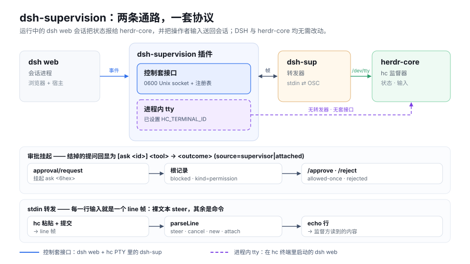

插件运行在本身就持有该会话的 `dsh web` 进程里，因此不需要重启或复制任何东西。
- **控制套接口（实线）：**插件在 `$DSH_HOME/supervision` 下提供一个 `0600` Unix 套接口；supervisor PTY 里的 `dsh-sup` 连上来，把 OSC 7501 与 echo 记录写到自己的 `/dev/tty`，并把所有者的 stdin 以 `line` 帧送回去。
- **进程内 tty（虚线）：**设置 `DSH_SUP_TERMINAL_ID`（或 herdr-core 的 `HC_TERMINAL_ID`）后，`dsh web` 同时把同样的记录写到自己的 `/dev/tty`；控制套接口仍然为别处的 `dsh-sup` 开着。
- **审批挂起：**来自被桥接会话树的 `approval/request` 以六位十六进制 id 挂起，根记录变成 `blocked · kind=permission`；`/approve` 或 `/reject` 把它结为 `allowed-once` 或 `rejected`。
- **stdin 转发：**每一行输入就是一个 `line` 帧——裸文本 steer，`/cancel`、`/status`、`/new`、`/attach`、`/approve`、`/reject`、`/y`、`/n` 是命令。
